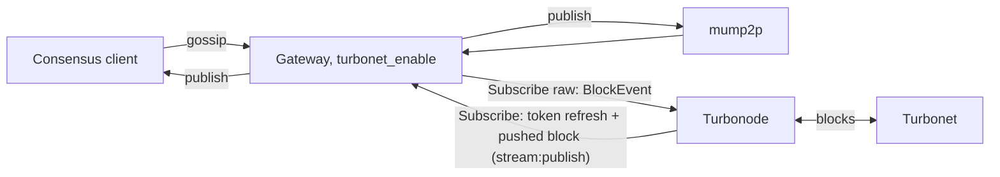

# ADR-0015: Turbonet integration — block push over the consumer stream

**Status:** Proposed
**Date:** 2026-11-26
**Related:** [ADR-0011](./0011-gateway-consumer-block-stream.md) (partially superseded: the gRPC stream gains a write path), [ADR-0002](./0002-beacon-block-latency.md), [ADR-0007](./0007-slot-based-block-arrival-tracking.md)

---

## Context

We want to test whether a dedicated inter-region network, **Turbonet**, delivers
beacon blocks between regions faster than mump2p alone. Terms are defined in
[`CONTEXT.md`](../../CONTEXT.md).

The experiment is an internal Optimum product:

* A handful of gateways per region form a **Turbo gateway cluster** (for example
  EU, US, Tokyo, Asia). Membership is chosen by hand and may grow or shrink.
  A Turbo gateway cluster is not a mump2p **Cluster** (`ClusterID`).
* Each of these gateways runs a special Docker image with two binaries: the
  gateway and a **Turbonode**. The Turbonode links its gateway to Turbonet.
* The gateways keep their existing gateway type (in practice `partner`). There
  is no new gateway type.

The Turbonode is outside this repository. Its flow is recorded here only as the
contract the gateway must serve:

1. The Turbonode subscribes to the gateway's gRPC block stream in `raw` mode and
   forwards every block it receives into Turbonet.
2. When the Turbonode receives a block from Turbonet, it pushes the block into
   the gateway over the same stream. The gateway processes it and publishes it
   to the consensus client (CL) and to mump2p.
3. The Turbonode drops any message whose xxHash it has already sent or received.
   This breaks loops: a pushed block comes back on the stream and is dropped,
   and a copy that reaches a sibling gateway over mump2p enters Turbonet once
   more and is dropped by every other Turbonode.
4. The Turbonode refreshes its stream token before it expires and sends the new
   token in-band on the same stream (ADR-0011, bidirectional `Subscribe`).
5. The Turbonode sets the gRPC client `MaxCallRecvMsgSize` above
   `consensus.MaxCompressedGossipSize()`. The default of 4 MiB breaks the raw
   subscription on a large block.

Today the stream is read-only. ADR-0011 records "any consumer write path —
read-only, always", and `aud=stream` is the only authorization; the `scope`
claim is not read for stream tokens. Step 2 needs both to change.

## Decision

### 1. Push over the existing gRPC `Subscribe`

`Subscribe` is already bidirectional (in-band token refresh). `SubscribeRequest`
gains one field carrying a block: the gossip payload, `snappy(SSZ(SignedBeaconBlock))`,
exactly as the stream emits it in `raw` mode. Bytes only — no topic.

* The first `SubscribeRequest` selects mode and topics, as today. A block on the
  first message is rejected with `InvalidArgument`: auth is not settled yet.
* A later message may carry a token, a block, or both. The token is applied
  first, so a push sent together with a refresh is checked against the new token.
* The WebSocket transport does not change. The Turbonode uses gRPC only.

There is no per-block acknowledgement. The outcome goes to gateway metrics and
logs (section 5); the Turbonode runs in the same container, so they are at hand.
An ack frame can be added later to the `BlockEvent` oneof without breaking
clients.

### 2. Who may push

A push is accepted only when all of these hold. Otherwise the gateway closes the
stream with `PermissionDenied`: a push without rights is a deployment error and
must be loud; the Turbonode reconnects and resubscribes.

1. **The gateway enables Turbonet:** new config `turbonet_enable` /
   `OPT_TURBONET_ENABLE`, default `false`. Only the internal image sets it. It
   requires `stream_enable`, checked at startup like `stream_only`.
2. **Stream auth is on.** With `requireAuth=false` (`allowAllAuthenticator`) no
   token exists to carry the grant.
3. **The current token carries the `stream:publish` grant.** New grant
   `stream:publish`, defined in `optimum-common` next to `p2p:publish` /
   `p2p:subscribe` (`GrantStreamPublish`). Reading the stream needs no grant; a
   token without `scope` reads exactly as today.
4. **The current token has not expired.** The gateway checks `exp` of the
   current claims on every push. Periodic re-auth (`stream_reauth_mode`) closes
   a stream only in `enforce`; the default `observe` does not, so without this
   check an expired token would keep push rights for the life of the stream.

The token is not bound to a gateway. That is acceptable: the flag limits push to
gateways that run a Turbonode.

**Concurrency.** Pushes arrive on the goroutine that calls `stream.Recv()`
(today `recvTokens`); the send loop stays the only writer and the only place
that returns a status. The current claims (grant and `exp`) live in one
`atomic.Pointer` shared by both goroutines: the receive goroutine stores a newly
verified token before it handles the block of the same message, and the send
loop's in-band and periodic re-verification store into the same pointer. A
rejected push is reported to the send loop over a channel, and the send loop
returns `PermissionDenied`.

### 3. Processing a pushed block

The push is processed on the receive goroutine. `processBeaconBlockArrival` is
already called concurrently from the CL and mump2p ingest goroutines, so a third
caller needs no new queue. The stream package gets a small publisher interface,
implemented by the gateway service and wired in `cmd/main.go`, so it does not
import the gateway package.

1. `processBeaconBlockArrival` with the new source `Source = turbonet`: decode
   the header, record arrival telemetry, emit to the stream hub, drop stale
   blocks (more than 3 slots behind).
2. `isDuplicateMessage`: drop a block the gateway has already handled from any
   source.
3. Build the topic from `forkMgr.ActiveDigest()`.
4. Publish to mump2p (`nodeMumP2P.PublishMessage`), with no extra gate, as for
   blocks from the CL.
5. Publish to the CL (`publishToCLTopic`) through the same gates as a block from
   mump2p: `propagationDisabled` and `ShouldForwardMessageToCLP2P`. There is no
   rule specific to `turbonet`; on a `partner` gateway the block always goes to
   the CL. In `stream_only` mode there is no CL host, and the block goes to
   mump2p only.

### 4. Message size

The stream gRPC server uses the default `MaxRecvMsgSize` of 4 MiB. A gossip
block may be up to `consensus.MaxCompressedGossipSize()` (over 10 MiB). The
server sets `grpc.MaxRecvMsgSize` above that limit plus the protobuf framing.
The Turbonode raises its receive limit the same way (Context, step 5).

### 5. Metrics

Turbonet arrivals go to the gateway's Prometheus metrics only. The gateway
otherwise works as before: the latency record sent to the centralized service
(`LatencyComparator`) does not change.

Today every telemetry function that takes a `Source` handles only `libp2p` and
`mump2p`, and silently drops any other value. Each one gains a `turbonet`
branch:

| Place                              | Change                                                                         |
| ---------------------------------- | ------------------------------------------------------------------------------ |
| `entities.Source`                  | add `SourceTurbonet = "turbonet"`                                              |
| `telemetry.IncBlocksFirstSeen`     | new counter for turbonet first-seen                                            |
| `telemetry.RecordBlockPathArrival` | replace `mumP2P bool` with the `Source`; record turbonet slot-relative arrival |
| `telemetry.IncreaseBadMessages`    | count turbonet decode failures under their own label                           |
| `telemetry.IncParseSSZError`       | its `else` branch treats every non-libp2p source as mump2p; split out turbonet |
| stream `BlockEvent.source`         | carries `turbonet` with no change                                              |

`bootstrapper.HandleBeaconBlock` keeps its two branches. A turbonet arrival
still counts toward first-seen for the slot, but fills no `LatencyComparator`
field.

New counter for push outcomes, labelled `accepted`, `duplicate`, `stale`,
`invalid`, `denied`. This is the only feedback the Turbonode gets (no ack).

**Evaluation.** The effect of Turbonet is judged by the per-block spread
`lastSeen − firstSeen` across gateways, from the existing arrival data. Turbonet
should shrink it. The per-source metrics above explain where a gain comes from;
they are not the success criterion.

### 6. Prerequisites outside this repository

* `optimum-common`: `GrantStreamPublish`.
* optimum-auth mints `aud=stream` tokens with `scope: "stream:publish"` for
  Turbonodes.

## Architecture

## Alternatives considered

* **A separate `Publish` RPC with a per-block ack.** Cleaner separation of read
  and write, but a second stream for one internal client. Rejected for now; an
  ack frame on `Subscribe` covers the same need if it appears.
* **Connect the Turbonode as a libp2p gossipsub peer of the gateway.** Needs no
  gateway change and can be limited by the `direct_cl_peers` allowlist, but the
  gateway would treat Turbonet blocks as CL blocks: no `turbonet` source, so no
  way to measure the experiment.
* **A new gateway type `turbo`.** Rejected: gateways on an older
  `optimum-common` treat an unknown type as unable to publish on mump2p (the
  `CanPublish` fallback), so the rollout would need a fleet-wide upgrade first.
  A local flag gives the same "only Turbonet gateways accept pushes" guarantee.
* **Let the client send the topic.** Correct across a fork boundary, but needs
  Turbonet to carry the topic. Rejected for simplicity; see Consequences.
* **Rely on periodic re-auth to end push rights.** It closes a stream only in
  `enforce` mode, which is not the default. A per-push `exp` check is one
  comparison.

## Consequences

* ADR-0011 "read-only, always" no longer holds for gRPC. WebSocket stays
  read-only.
* The gateway does not verify the proposer signature of a pushed block. An
  invalid block lowers the gossipsub score of the gateway itself at its CL
  peers. Trust rests on the flag and the `stream:publish` grant.
* Both the gateway and the Turbonode deduplicate by xxHash of the
  snappy-compressed bytes. Two different encodings of one block pass twice. The
  gateway already lives with this limit.
* At a fork boundary a block of the other fork lands in the topic of the active
  digest. CL peers fail to decode it and REJECT it, which penalizes the
  gateway's gossipsub score; mump2p peers get it under the wrong topic too.
  Accepted for the experiment: forks are rare, and the Turbonode can skip blocks
  whose `fork_digest` in the stream event differs from the one it expects. Add
  the topic to the push if it becomes a problem.
* A block that reaches several gateways of one Turbo gateway cluster over
  mump2p enters Turbonet once per gateway. Turbonode dedup drops the copies;
  the cost is extra Turbonet traffic.
* The Turbonode must keep its token fresh. If it stops refreshing, the first
  push after `exp` closes the stream.

## Non-goals

* Push over WebSocket.
* Pushing attestations or other topics.
* Turbonode internals: Turbonet transport, peer selection, Turbo gateway
  cluster membership.
* Signature verification of pushed blocks in the gateway.
* A new gateway type.
